# CẨM NANG BẢO VỆ ĐỒ ÁN VÀ TRẢ LỜI PHỎNG VẤN (INTERVIEW DEFENSE GUIDE)
## SBA301 • Assignment 02 • CRUD Application with RESTful Web Service and ReactJS
**Sinh viên thực hiện:** Lâm Đăng Kỳ Anh | **MSSV:** CE190574 | **Lớp:** SE1910  
**Tên Đồ Án:** FUNewsManagementSystem  
**Database:** `A2LamDangKyAnh_SE1910` (MS SQL Server)  
**Backend:** Spring Boot 3 RESTful API 3-Layer Architecture  
**Frontend:** ReactJS Single Page Application (Axios, Bootstrap 5)

---

## 📑 MỤC LỤC TỔNG QUAN

1. [PHẦN 1: TỔNG QUAN VÀ RUBRIC CHẤM ĐIỂM (4 TIÊU CHÍ / 10 ĐIỂM)](#phần-1-tổng-quan-và-rubric-chấm-điểm)
2. [PHẦN 2: QUY TRÌNH 5 BƯỚC PHỎNG VẤN THỰC CHIẾN](#phần-2-quy-trình-5-bước-phỏng-vấn-thực-chiến)
   - [Pha 1: Run - Khởi động và kiểm tra nhanh](#pha-1-run---khởi-động-và-kiểm-tra-nhanh)
   - [Pha 2: Personal Git - Chứng minh tiến trình phát triển](#pha-2-personal-git---chứng-minh-tiến-trình-phát-triển)
   - [Pha 3: Explain - Trình bày bài toán và kiến trúc](#pha-3-explain---trình-bày-bài-toán-và-kiến-trúc)
   - [Pha 4: Code Interview - Truy vết mã nguồn theo khung chuẩn](#pha-4-code-interview---truy-vết-mã-nguồn-theo-khung-chuẩn)
   - [Pha 5: Adaptation - Phân tích thay đổi và Live Modification](#pha-5-adaptation---phân-tích-thay-đổi-và-live-modification)
3. [PHẦN 3: HÌNH ẢNH DEMO GIAO DIỆN & GIẢI THÍCH CHI TIẾT TỪNG MÀN HÌNH](#phần-3-hình-ảnh-demo-giao-diện--giải-thích-chi-tiết)
   - [3.1 Màn hình Public News Portal & Đọc bài viết](#31-màn-hình-public-news-portal--đọc-bài-viết)
   - [3.2 Màn hình Đăng nhập (Authentication)](#32-màn-hình-đăng-nhập-authentication)
   - [3.3 Màn hình Admin: Quản lý tài khoản (Account Management)](#33-màn-hình-admin-quản-lý-tài-khoản)
   - [3.4 Màn hình Staff: Quản lý bài viết tin tức (News Management)](#34-màn-hình-staff-quản-lý-bài-viết-tin-tức)
   - [3.5 Màn hình Staff: Quản lý danh mục (Category Management)](#35-màn-hình-staff-quản-lý-danh-mục)
   - [3.6 Màn hình Staff: Lịch sử viết bài & Quản lý hồ sơ](#36-màn-hình-staff-lịch-sử-viết-bài--quản-lý-hồ-sơ)
4. [PHẦN 4: TRUY VẾT MÃ NGUỒN 6 LUỒNG CỐT LÕI (END-TO-END CODE TRACE)](#phần-4-truy-vết-mã-nguồn-6-luồng-cốt-lõi)
   - [Luồng 1: Xem tin tức công khai không cần đăng nhập](#luồng-1-xem-tin-tức-công-khai-không-cần-đăng-nhập)
   - [Luồng 2: Xác thực tài khoản Member/Staff (Login)](#luồng-2-xác-thực-tài-khoản-memberstaff-login)
   - [Luồng 3: Ràng buộc xóa tài khoản Admin (Account Deletion Rule)](#luồng-3-ràng-buộc-xóa-tài-khoản-admin-account-deletion-rule)
   - [Luồng 4: Ràng buộc xóa danh mục Staff (Category Deletion Rule)](#luồng-4-ràng-buộc-xóa-danh-mục-staff-category-deletion-rule)
   - [Luồng 5: Tạo / Cập nhật bài viết kèm quan hệ Tags](#luồng-5-tạo--cập-nhật-bài-viết-kèm-quan-hệ-tags)
   - [Luồng 6: Xem lịch sử bài viết do Staff tạo (News History)](#luồng-6-xem-lịch-sử-bài-viết-do-staff-tạo-news-history)
5. [PHẦN 5: BỘ CÂU HỎI PHỎNG VẤN CHUYÊN SÂU & ĐÁP ÁN CHUẨN (Q&A)](#phần-5-bộ-câu-hỏi-phỏng-vấn-chuyên-sâu)
6. [PHẦN 6: CHECKLIST 5 PHÚT TRƯỚC KHI BƯỚC VÀO PHÒNG PHỎNG VẤN](#phần-6-checklist-5-phút-trước-khi-bước-vào-phòng-phỏng-vấn)

---

## PHẦN 1: TỔNG QUAN VÀ RUBRIC CHẤM ĐIỂM

Giảng viên đánh giá buổi phỏng vấn Assignment 02 theo chuẩn 4 tiêu chí (Thang điểm 10):

| Mã tiêu chí | Tên tiêu chí | Trọng số | Yêu cầu chứng minh của sinh viên |
|---|---|:---:|---|
| **C1** | **Problem Understanding & Solution Approach** | **1.5 điểm** | Nắm chắc yêu cầu bài toán FUNewsManagementSystem, các thực thể, ràng buộc nghiệp vụ (NewsStatus, IsActive, AccountRole, ràng buộc khóa ngoại khi xóa) và giải thích cấu trúc 3-Layer. |
| **C2** | **Individual Engineering Process & Git Evidence** | **2.0 điểm** | Chứng minh repository cá nhân, commit history thể hiện rõ quá trình: Phân chia commit rõ ràng giữa Backend và Frontend, sửa lỗi CORS, bổ sung docs. |
| **C3** | **Functional Implementation** | **1.5 điểm** | Khởi động Backend (Spring Boot 8080) và Frontend (Vite 5173), demo mượt mà các chức năng CRUD, Modal Popup, xác nhận xóa, không có lỗi vỡ luồng. |
| **C4** | **Code Understanding, Explanation & Adaptation** | **5.0 điểm** *(Trọng tâm)* | Mở đúng file/function khi được hỏi; giải thích dữ liệu, trạng thái, luồng đi từ UI -> Axios -> Controller -> Service -> Repository -> Database; phân tích change impact và sửa code trực tiếp nếu được yêu cầu. |

> **Thông điệp cốt lõi:** C4 chiếm một nửa tổng số điểm (5/10đ) để khẳng định sinh viên tự tay làm và làm chủ mã nguồn. Trả lời mạch lạc theo khung chuẩn sẽ giúp bạn đạt điểm tối đa mà không bị giảng viên yêu cầu live modification phức tạp.

---

## PHẦN 2: QUY TRÌNH 5 BƯỚC PHỎNG VẤN THỰC CHIẾN

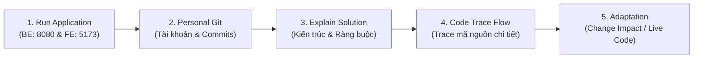

### Pha 1: Run - Khởi động và kiểm tra nhanh
Khi bước vào phòng interview, hãy mở sẵn 2 cửa sổ Terminal:
1. **Terminal 1 (Backend):**
   ```powershell
   cd backend
   mvn spring-boot:run
   ```
   *Kiểm tra dòng log:* `Tomcat started on port 8080 (http) with context path ''` và `Started A2LamDangKyAnhSe1910Application`.
2. **Terminal 2 (Frontend):**
   ```powershell
   cd frontend
   npm run dev
   ```
   *Mở trình duyệt tại:* `http://localhost:5173/`

### Pha 2: Personal Git - Chứng minh tiến trình phát triển
Mở terminal và gõ lệnh:
```powershell
git log -n 5 --graph --oneline
```
Kết quả hiển thị minh chứng rõ ràng:
- `948974a docs: add comprehensive README documentation and API guide for A2LamDangKyAnh_SE1910`
- `9fdb2a2 feat(frontend): implement ReactJS client with Axios and popup modals for A2LamDangKyAnh_SE1910`
- `97f7baa fix(backend): optimize CORS credentials and streamline controller annotations`
- `b2aef6c feat(backend): implement Spring Boot 3 RESTful API with 3-layer architecture for A2LamDangKyAnh_SE1910`
- `12b73f0 feat: add React frontend application and Java Hibernate backend project structure`

> **Giải thích với giảng viên:** *"Em đã phân tách quá trình phát triển rất rõ ràng: Khởi tạo Backend Spring Boot 3 trước với 3-Layer Architecture và kiểm thử ràng buộc database, sau đó tinh chỉnh CORS, tiếp tục phát triển Frontend ReactJS tích hợp qua Axios, và cuối cùng hoàn thiện tài liệu hướng dẫn."*

### Pha 3: Explain - Trình bày bài toán và kiến trúc
- **Bài toán:** Quản lý xuất bản tin tức nội bộ trường học với 2 nhóm người dùng có quyền hạn khác nhau:
  - **Khách vãng lai (Public):** Xem các tin tức đang được kích hoạt (`NewsStatus = 1`), tìm kiếm và đọc chi tiết.
  - **Admin (`AccountRole = 1`):** Quản lý tài khoản (CRUD & Search). Ràng buộc: Không được xóa tài khoản nếu tài khoản đó đã từng tạo bài viết tin tức.
  - **Staff (`AccountRole = 2`):** Quản lý danh mục (Category) với ràng buộc không được xóa danh mục nếu đang có bài viết sử dụng; Quản lý bài viết tin tức (NewsArticle) đa thẻ tag; Quản lý hồ sơ cá nhân và theo dõi lịch sử bài viết do chính mình tạo.
- **Kiến trúc:**
  - **Backend (Spring Boot 3):** 3-Layer Architecture:
    - `Controller`: Tiếp nhận HTTP Request, validate DTO (`@Valid`), ánh xạ Response JSON.
    - `Service`: Chứa toàn bộ nghiệp vụ và ràng buộc (Business Logic, Transactional).
    - `Repository`: Kế thừa `JpaRepository`, thực hiện câu lệnh truy vấn dữ liệu SQL Server.
    - `Entity`: Ánh xạ cấu trúc bảng cơ sở dữ liệu qua JPA/Hibernate.
  - **Frontend (ReactJS):** Component-based, tách lớp `api.js` dùng Axios, quản lý trạng thái qua React Hooks (`useState`, `useEffect`), toàn bộ thao tác Thêm/Sửa đều thực hiện qua Popup Modal, thao tác Xóa luôn đi kèm xác nhận (Confirm Dialog).

### Pha 4: Code Interview - Truy vết mã nguồn theo khung chuẩn
Khi giảng viên yêu cầu mở một chức năng, áp dụng công thức **8 bước trả lời súc tích**:
> **`Purpose`** (Mục đích) $\rightarrow$ **`Input`** (Dữ liệu đầu vào) $\rightarrow$ **`Trigger`** (Sự kiện kích hoạt) $\rightarrow$ **`Processing/State`** (Xử lý và thay đổi dữ liệu) $\rightarrow$ **`Output`** (Kết quả trả về) $\rightarrow$ **`Failure`** (Trường hợp lỗi/biên) $\rightarrow$ **`Why`** (Vì sao thiết kế như vậy) $\rightarrow$ **`Change Impact`** (Nếu đổi yêu cầu thì sửa ở đâu).

### Pha 5: Adaptation - Phân tích thay đổi và Live Modification
Khi giảng viên hỏi: *"Nếu tôi muốn đổi quy tắc X thì em sửa ở đâu?"*:
1. Nhắc lại yêu cầu để xác nhận bạn đã hiểu đúng ý thầy/cô.
2. Nêu chính xác tên file và method bị ảnh hưởng (ví dụ: `NewsArticleService.java` -> method `createNews`).
3. Chỉ ra các tầng liên đới: DTO -> Service -> UI form.
4. Nếu được yêu cầu sửa: Chỉ viết thay đổi nhỏ nhất, nhấn Lưu, re-compile hoặc để Vite HMR tự cập nhật, sau đó demo lại trên màn hình.

---

## PHẦN 3: HÌNH ẢNH DEMO GIAO DIỆN & GIẢI THÍCH CHI TIẾT

### 3.1 Màn hình Public News Portal & Đọc bài viết
Màn hình công khai cho phép sinh viên, giảng viên và công chúng đọc tin tức mà **không cần đăng nhập**.

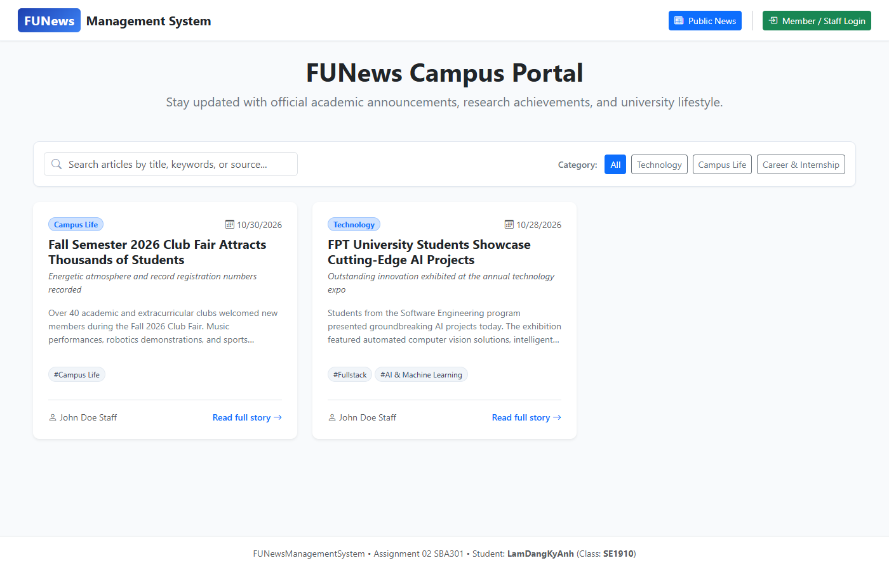

- **Chi tiết giao diện:**
  - Thanh tìm kiếm tức thời theo từ khóa trong tiêu đề, tóm tắt hoặc nội dung.
  - Thanh phân loại danh mục (Filter pills): All, Technology, Campus Life, Career & Internship.
  - Thẻ bài viết (Cards) hiển thị: Tiêu đề, badge danh mục, ngày xuất bản, tác giả, tóm tắt headline và danh sách thẻ tags (`#AI & Machine Learning`, `#Fullstack`,...).
  - **Đặc điểm nghiệp vụ:** Endpoint `GET /api/news/public` chỉ lọc các tin có `newsStatus = true`. Các bài viết bản nháp (`newsStatus = false`) tuyệt đối không xuất hiện ở đây.

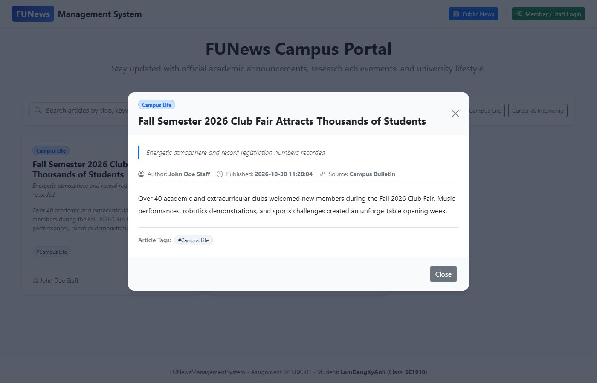

- **Popup đọc chi tiết bài viết (Reading Modal):**
  - Người dùng click vào thẻ bài viết bất kỳ để mở Modal đọc toàn văn.
  - Hiển thị đầy đủ thông tin: Headline trích dẫn, tác giả, ngày giờ xuất bản chính xác, nguồn tin tức (Source), toàn bộ nội dung phân đoạn và danh sách thẻ bài viết.

---

### 3.2 Màn hình Đăng nhập (Authentication)

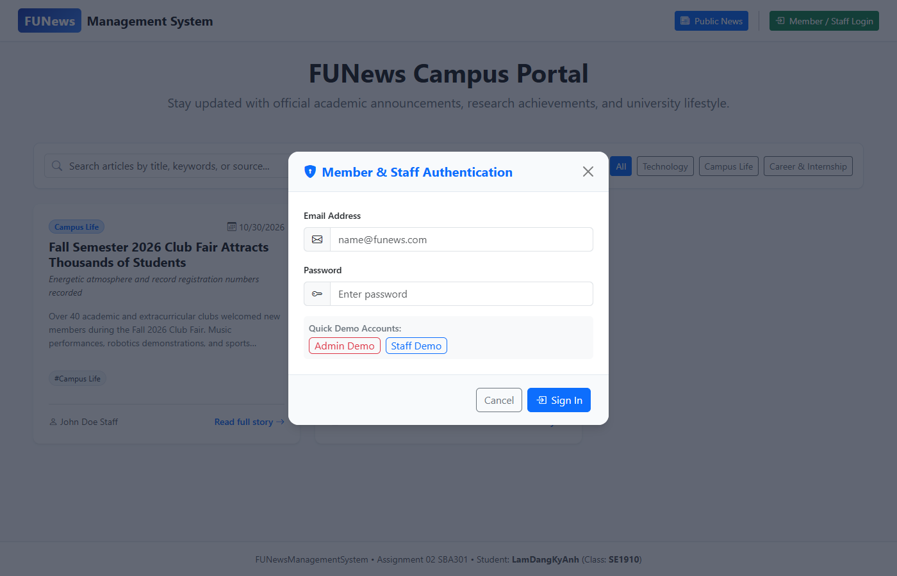

- **Chi tiết giao diện & Kỹ thuật:**
  - Popup Dialog đăng nhập với Email và Password.
  - Tích hợp 2 nút tiện ích **"Admin Demo"** và **"Staff Demo"** hỗ trợ điền nhanh tài khoản mẫu giúp kiểm thử và bảo vệ đồ án diễn ra nhanh chóng:
    - Admin: `admin@funews.com` / `admin123`
    - Staff: `staff@funews.com` / `staff123`
  - Backend API: `POST /api/auth/login` kiểm tra mật khẩu và email trong bảng `SystemAccount`, trả về DTO gồm `accountId`, `accountName`, `accountEmail`, `accountRole`.
  - Frontend lưu trữ phiên làm việc vào `localStorage` (`funews_current_user`), tự động điều hướng sang workspace tương ứng với role của người dùng.

---

### 3.3 Màn hình Admin: Quản lý tài khoản (Account Management)

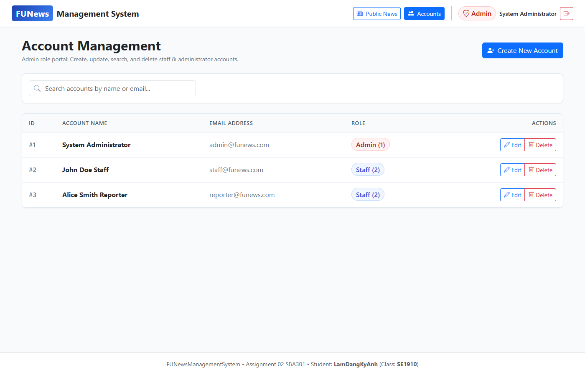

- **Chức năng Admin:**
  - Bảng danh sách tài khoản toàn hệ thống hiển thị: ID, Họ tên, Email, Huy hiệu phân quyền (`Admin (1)` - màu đỏ, `Staff (2)` - màu xanh), và các nút Thao tác.
  - Thanh tìm kiếm theo tên hoặc email (`GET /api/accounts?query=...`).
  - Nút **"Create New Account"** mở Popup Modal thêm mới.

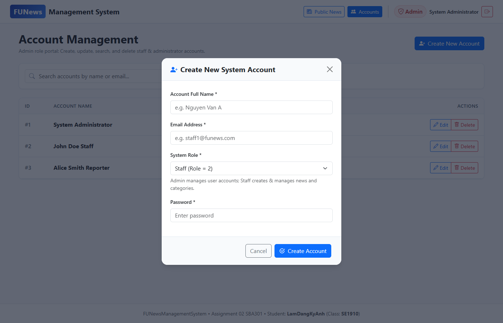

- **Popup Dialog Thêm/Sửa Tài Khoản:**
  - Form xác thực kiểm tra dữ liệu đầu vào: Họ tên (tối đa 100 ký tự), Email hợp lệ (Regex format), phân quyền Role (1 hoặc 2), Mật khẩu (tối đa 70 ký tự).
  - Khi chỉnh sửa, mật khẩu có thể để trống nếu không muốn thay đổi.

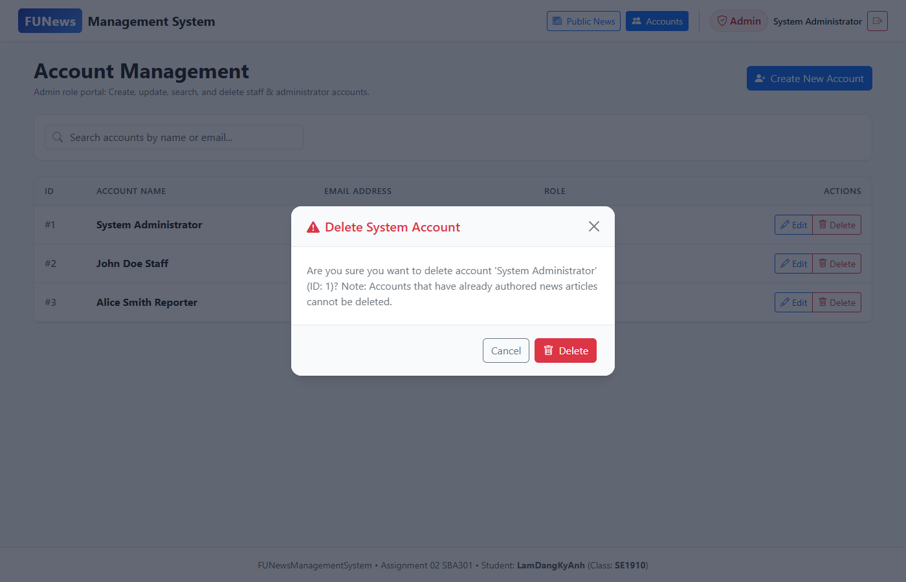

- **Modal Xác Nhận Xóa & Ràng Buộc Nghiệp Vụ:**
  - Mọi thao tác Xóa đều mở Popup xác nhận màu đỏ cảnh báo.
  - **Ràng buộc đặc biệt (Business Constraint):** Nếu tài khoản đó đã từng tạo bất kỳ bài viết tin tức nào (`NewsArticle`), Backend sẽ ném mã lỗi HTTP 400 Bad Request: *"Cannot delete account: Account 'John Doe Staff' (ID: 2) has already created news articles in the system."* và hiển thị thông báo lỗi trực quan trên UI.

---

### 3.4 Màn hình Staff: Quản lý bài viết tin tức (News Management)

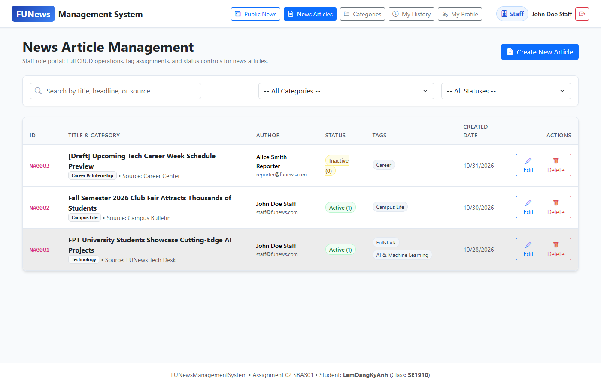

- **Chức năng Staff:**
  - Hiển thị toàn bộ các bài viết (cả Active xuất bản và Inactive bản nháp).
  - Bộ lọc kết hợp 3 tiêu chí: Ô tìm kiếm từ khóa + Dropdown chọn Danh mục + Dropdown chọn Trạng thái (Tất cả / Active / Draft).
  - Cột Tags hiển thị trực quan các thẻ liên kết của bài viết.

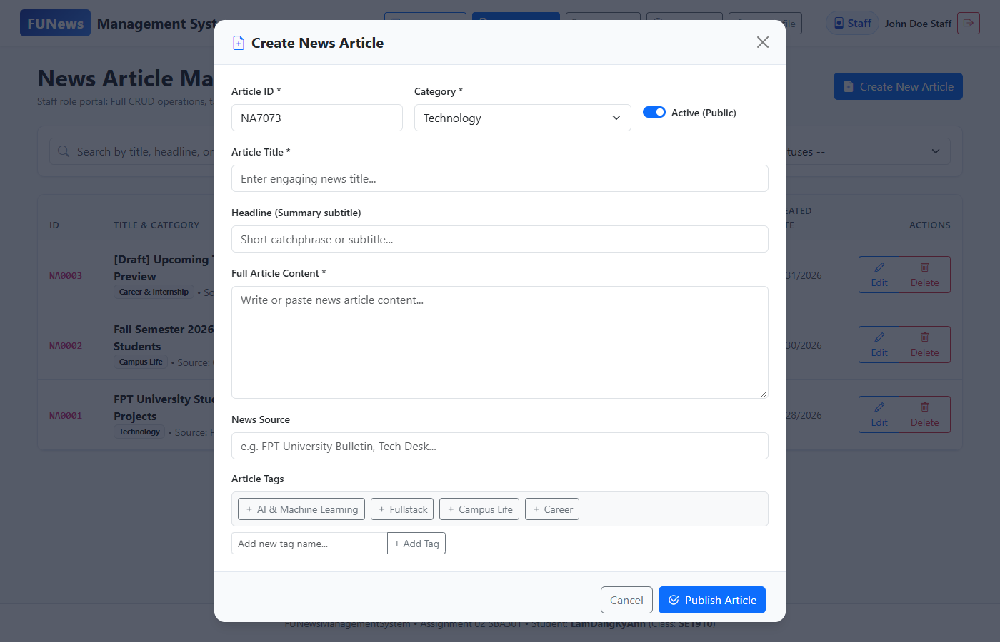

- **Popup Soạn Thảo Tin Tức:**
  - Cung cấp trường Article ID (tự sinh mã hoặc nhập tay), Tiêu đề (bắt buộc), Headline, Dropdown Danh mục được lấy động từ Database, Toàn văn nội dung, Nguồn tin.
  - Toggle switch chuyển trạng thái: `Active (Public)` hoặc `Inactive (Draft)`.
  - Khung gắn Tags đa lựa chọn: Click để bật/tắt thẻ; hỗ trợ ô nhập nhanh để tạo và gắn thẻ mới trực tiếp ngay trong modal.

---

### 3.5 Màn hình Staff: Quản lý danh mục (Category Management)

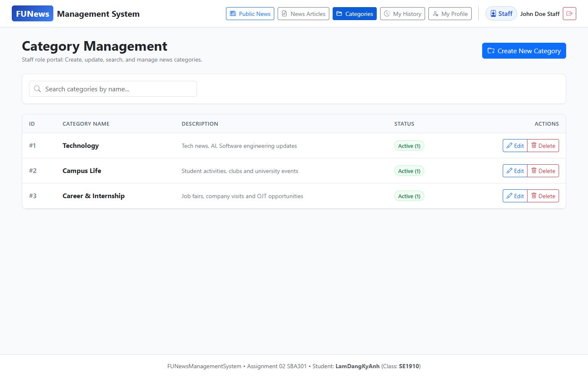

- **Chức năng Quản lý Danh mục:**
  - Bảng danh mục gồm: ID, Tên danh mục, Mô tả, Trạng thái (Active/Inactive), Nút Thao tác Sửa/Xóa.
  - Thanh tìm kiếm danh mục theo tên.

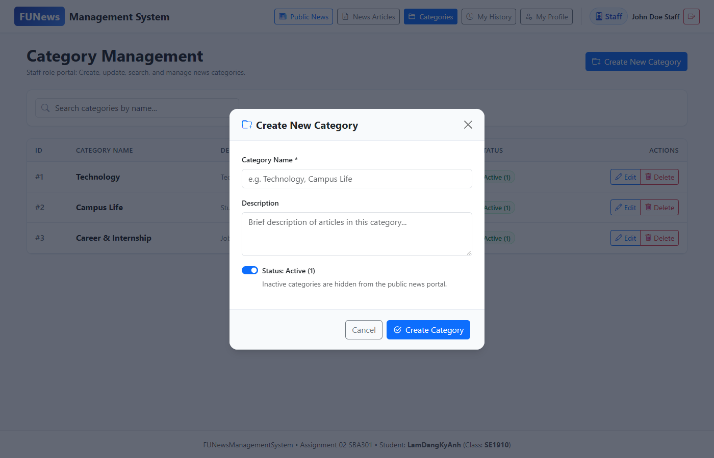

- **Popup Thêm/Sửa Danh mục:**
  - Nhập tên danh mục (validate tối đa 100 ký tự, kiểm tra trùng lặp trên backend), mô tả (tối đa 500 ký tự), switch bật tắt trạng thái hoạt động.
  - **Ràng buộc khi xóa danh mục:** Backend kiểm tra `newsArticleRepository.existsByCategory_CategoryId()`. Nếu danh mục đang có bài viết sử dụng, hệ thống ngăn chặn việc xóa và trả thông báo lỗi 400 rõ ràng.

---

### 3.6 Màn hình Staff: Lịch sử viết bài & Quản lý hồ sơ

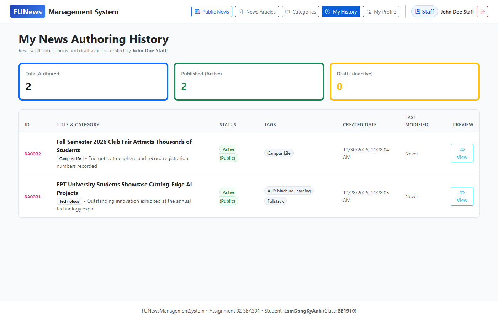

- **Màn hình Lịch sử viết bài (My History):**
  - Giúp nhân viên theo dõi toàn bộ các ấn phẩm do chính mình tạo ra (`CreatedByID = CurrentStaff.AccountId`).
  - 3 Thẻ thống kê KPI trên đầu trang:
    1. **Total Authored:** Tổng số bài viết đã soạn.
    2. **Published (Active):** Số bài viết đang phát hành trực tuyến.
    3. **Drafts (Inactive):** Số bản thảo đang lưu nháp nội bộ.
  - Nút "View" mở xem nhanh nội dung bài viết.

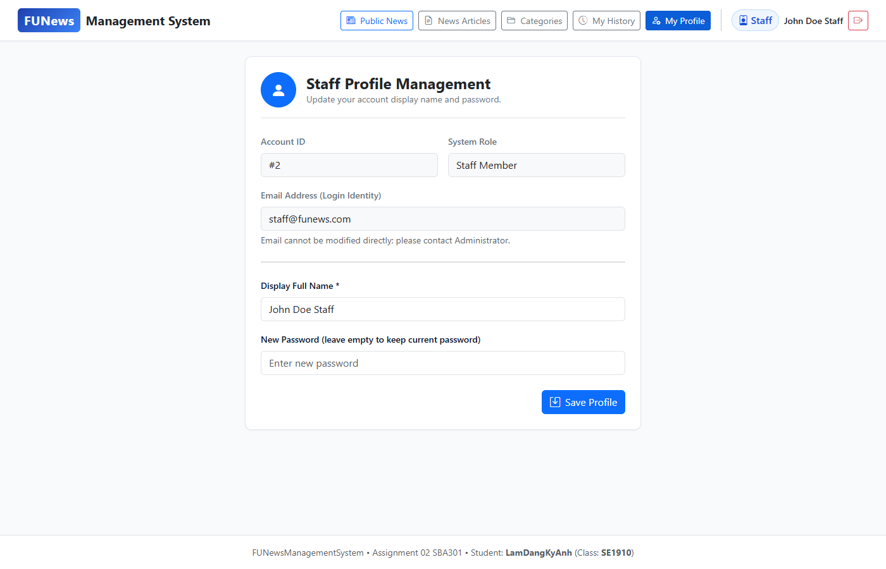

- **Màn hình Hồ sơ cá nhân (My Profile):**
  - Hiển thị các trường cố định: Account ID, Phân quyền hệ thống, Email đăng nhập.
  - Cho phép Staff cập nhật Tên hiển thị và Mật khẩu mới (có ô xác nhận mật khẩu để đảm bảo không nhập sai).

---

## PHẦN 4: TRUY VẾT MÃ NGUỒN 6 LUỒNG CỐT LÕI (END-TO-END CODE TRACE)

### Luồng 1: Xem tin tức công khai không cần đăng nhập
* **Mục đích:** Khách truy cập xem danh sách tin tức đã xuất bản mà không cần tài khoản.
* **Trigger:** Khi mở ứng dụng tại tab `public` hoặc click nút "Public News" trên Navbar.
* **Trace flow qua mã nguồn:**
  1. **Frontend:** [PublicNewsPage.jsx](file:///d:/Ky7_FA2026/SBA301/A2LamDangKyAnh_SE1910/frontend/src/pages/public/PublicNewsPage.jsx#L20-L36) gọi hook `useEffect`, thực thi:
     ```javascript
     const [newsData, catData] = await Promise.all([
       newsService.getPublic(),
       categoryService.getActive()
     ]);
     ```
  2. **Axios Client:** [api.js](file:///d:/Ky7_FA2026/SBA301/A2LamDangKyAnh_SE1910/frontend/src/services/api.js#L125-L132) gửi request `GET http://localhost:8080/api/news/public`.
  3. **Backend Controller:** [NewsArticleController.java](file:///d:/Ky7_FA2026/SBA301/A2LamDangKyAnh_SE1910/backend/src/main/java/com/sba301/funews/controller/NewsArticleController.java#L30-L33) đón nhận request:
     ```java
     @GetMapping("/public")
     public ResponseEntity<List<NewsArticle>> getPublicActiveNews() {
         return ResponseEntity.ok(newsArticleService.getPublicActiveNews());
     }
     ```
  4. **Backend Service:** [NewsArticleService.java](file:///d:/Ky7_FA2026/SBA301/A2LamDangKyAnh_SE1910/backend/src/main/java/com/sba301/funews/service/NewsArticleService.java#L40-L42):
     ```java
     public List<NewsArticle> getPublicActiveNews() {
         return newsArticleRepository.findByNewsStatusTrueOrderByCreatedDateDesc();
     }
     ```
  5. **Repository & SQL:** [NewsArticleRepository.java](file:///d:/Ky7_FA2026/SBA301/A2LamDangKyAnh_SE1910/backend/src/main/java/com/sba301/funews/repository/NewsArticleRepository.java#L19):
     Spring Data JPA tự động dịch thành câu lệnh SQL:
     ```sql
     SELECT * FROM NewsArticle WHERE NewsStatus = 1 ORDER BY CreatedDate DESC;
     ```
  6. **Kết quả:** Trả về danh sách JSON chứa các bài viết Active kèm thực thể liên kết Category, CreatedBy, Tags.

---

### Luồng 2: Xác thực tài khoản Member/Staff (Login)
* **Mục đích:** Kiểm tra thông tin đăng nhập và phân quyền Admin/Staff.
* **Trigger:** Người dùng điền Email, Password trong LoginModal và click "Sign In".
* **Trace flow qua mã nguồn:**
  1. **Frontend:** [LoginModal.jsx](file:///d:/Ky7_FA2026/SBA301/A2LamDangKyAnh_SE1910/frontend/src/components/modals/LoginModal.jsx#L18-L33) gọi `authService.login(email, password)`.
  2. **Axios Client:** [api.js](file:///d:/Ky7_FA2026/SBA301/A2LamDangKyAnh_SE1910/frontend/src/services/api.js#L29-L38) gửi `POST http://localhost:8080/api/auth/login` với body JSON.
  3. **Backend Controller:** [AuthController.java](file:///d:/Ky7_FA2026/SBA301/A2LamDangKyAnh_SE1910/backend/src/main/java/com/sba301/funews/controller/AuthController.java#L18-L21):
     ```java
     @PostMapping("/login")
     public ResponseEntity<LoginResponse> login(@Valid @RequestBody LoginRequest request) {
         return ResponseEntity.ok(authService.login(request));
     }
     ```
  4. **Backend Service:** [AuthService.java](file:///d:/Ky7_FA2026/SBA301/A2LamDangKyAnh_SE1910/backend/src/main/java/com/sba301/funews/service/AuthService.java#L19-L34):
     - Tìm kiếm tài khoản theo email không phân biệt chữ hoa/thường: `accountRepository.findByAccountEmailIgnoreCase(...)`.
     - Nếu không thấy: ném `ResponseStatusException(HttpStatus.UNAUTHORIZED, "Invalid email or password")`.
     - So khớp mật khẩu: Nếu không khớp, ném lỗi 401.
     - Trả về `LoginResponse` chứa thông tin người dùng và phân quyền `AccountRole`.
  5. **State Update:** [App.jsx](file:///d:/Ky7_FA2026/SBA301/A2LamDangKyAnh_SE1910/frontend/src/App.jsx#L26-L35) nhận response, lưu vào `localStorage`, cập nhật state `currentUser`, và tự động điều hướng: Nếu Role = 1 (Admin) chuyển về tab `accounts`, nếu Role = 2 (Staff) chuyển về tab `news`.

---

### Luồng 3: Ràng buộc xóa tài khoản Admin (Account Deletion Rule)
* **Mục đích:** Thực hiện nghiệp vụ trong PDF: *"the delete action will delete an account in the case this account is not belong to any news articles (created), if the account is already created any news article, cannot delete."*
* **Trigger:** Admin click nút Delete tại một dòng tài khoản trong bảng Account Management và xác nhận trong ConfirmModal.
* **Trace flow qua mã nguồn:**
  1. **Frontend:** [AccountManagementPage.jsx](file:///d:/Ky7_FA2026/SBA301/A2LamDangKyAnh_SE1910/frontend/src/pages/accounts/AccountManagementPage.jsx#L71-L86) gọi `accountService.delete(id)`.
  2. **Backend Controller:** [SystemAccountController.java](file:///d:/Ky7_FA2026/SBA301/A2LamDangKyAnh_SE1910/backend/src/main/java/com/sba301/funews/controller/SystemAccountController.java#L43-L47):
     ```java
     @DeleteMapping("/{id}")
     public ResponseEntity<Void> deleteAccount(@PathVariable Short id) {
         accountService.deleteAccount(id);
         return ResponseEntity.noContent().build();
     }
     ```
  3. **Backend Service:** [SystemAccountService.java](file:///d:/Ky7_FA2026/SBA301/A2LamDangKyAnh_SE1910/backend/src/main/java/com/sba301/funews/service/SystemAccountService.java#L70-L84):
     ```java
     @Transactional
     public void deleteAccount(Short id) {
         SystemAccount existing = getAccountById(id);

         // PDF Business Rule: Không được xóa nếu đã từng tạo bài viết tin tức
         if (newsArticleRepository.existsByCreatedBy_AccountId(id)) {
             throw new ResponseStatusException(HttpStatus.BAD_REQUEST,
                     "Cannot delete account: Account '" + existing.getAccountName() + "' (ID: " + id + ") has already created news articles in the system.");
         }

         accountRepository.delete(existing);
     }
     ```
  4. **Xử lý lỗi:** Nếu tài khoản vi phạm ràng buộc, Backend trả về HTTP 400 kèm thông báo lý do. Frontend bắt ngoại lệ tại `catch (err)` và hiển thị thông báo alert màu đỏ trên đầu trang.

---

### Luồng 4: Ràng buộc xóa danh mục Staff (Category Deletion Rule)
* **Mục đích:** Thực hiện nghiệp vụ trong PDF: *"The delete action will delete an item in the case this item is not belong to any news articles. If the item is already stored in a news article cannot delete."*
* **Trigger:** Staff click nút Delete tại một danh mục và nhấn xác nhận trên Modal.
* **Trace flow qua mã nguồn:**
  1. **Backend Service:** [CategoryService.java](file:///d:/Ky7_FA2026/SBA301/A2LamDangKyAnh_SE1910/backend/src/main/java/com/sba301/funews/service/CategoryService.java#L72-L84):
     ```java
     @Transactional
     public void deleteCategory(Short id) {
         Category existing = getCategoryById(id);

         // PDF Business Rule: Không được xóa nếu đang có bài viết sử dụng danh mục này
         if (newsArticleRepository.existsByCategory_CategoryId(id)) {
             throw new ResponseStatusException(HttpStatus.BAD_REQUEST,
                     "Cannot delete category: Category '" + existing.getCategoryName() + "' (ID: " + id + ") is currently assigned to one or more news articles.");
         }

         categoryRepository.delete(existing);
     }
     ```
  2. Nếu không có bài viết nào trỏ tới (`existsByCategory_CategoryId(id) == false`), thực hiện xóa an toàn khỏi database.

---

### Luồng 5: Tạo / Cập nhật bài viết kèm quan hệ Tags
* **Mục đích:** Staff đăng tin bài mới hoặc cập nhật nội dung bài viết, phân loại danh mục và đính kèm nhiều thẻ tags (Quan hệ Many-to-Many).
* **Trigger:** Staff nhập thông tin vào `NewsModal.jsx` và bấm "Publish Article" hoặc "Save Changes".
* **Trace flow qua mã nguồn:**
  1. **Frontend:** [NewsModal.jsx](file:///d:/Ky7_FA2026/SBA301/A2LamDangKyAnh_SE1910/frontend/src/components/modals/NewsModal.jsx#L118-L136) thu thập form state gồm `tagIds: [1, 2]`, `categoryId: 1`, `createdById: currentUser.accountId`.
  2. **Backend Controller:** [NewsArticleController.java](file:///d:/Ky7_FA2026/SBA301/A2LamDangKyAnh_SE1910/backend/src/main/java/com/sba301/funews/controller/NewsArticleController.java#L45-L53).
  3. **Backend Service:** [NewsArticleService.java](file:///d:/Ky7_FA2026/SBA301/A2LamDangKyAnh_SE1910/backend/src/main/java/com/sba301/funews/service/NewsArticleService.java#L50-L89):
     ```java
     @Transactional
     public NewsArticle createNews(NewsArticleRequest req) {
         NewsArticle article = new NewsArticle();
         article.setNewsArticleId(req.getNewsArticleId());
         article.setNewsTitle(req.getNewsTitle());
         article.setCategory(categoryRepository.findById(req.getCategoryId()).orElseThrow(...));
         article.setCreatedBy(accountRepository.findById(req.getCreatedById()).orElseThrow(...));
         article.setCreatedDate(LocalDateTime.now());
         article.setNewsStatus(req.getNewsStatus());

         // Xử lý quan hệ Many-to-Many với Tag
         if (req.getTagIds() != null && !req.getTagIds().isEmpty()) {
             Set<Tag> tags = new HashSet<>(tagRepository.findAllById(req.getTagIds()));
             article.setTags(tags);
         }

         return newsArticleRepository.save(article);
     }
     ```
  4. **JPA Mapping:** Entity [NewsArticle.java](file:///d:/Ky7_FA2026/SBA301/A2LamDangKyAnh_SE1910/backend/src/main/java/com/sba301/funews/entity/NewsArticle.java#L61-L67) sử dụng bảng trung gian `@JoinTable(name = "NewsTag")`. Hibernate tự động chèn các cặp khóa `(NewsArticleID, TagID)` vào bảng `NewsTag` trong cùng một transaction.

---

### Luồng 6: Xem lịch sử bài viết do Staff tạo (News History)
* **Mục đích:** Đáp ứng yêu cầu: *"View news history created by him/her"*.
* **Trigger:** Staff click vào tab "My History" trên thanh Navbar.
* **Trace flow qua mã nguồn:**
  1. **Frontend:** [NewsHistoryPage.jsx](file:///d:/Ky7_FA2026/SBA301/A2LamDangKyAnh_SE1910/frontend/src/pages/profile/NewsHistoryPage.jsx#L19-L30) gọi API `newsService.getStaffHistory(currentUser.accountId)`.
  2. **Backend Controller:** [NewsArticleController.java](file:///d:/Ky7_FA2026/SBA301/A2LamDangKyAnh_SE1910/backend/src/main/java/com/sba301/funews/controller/NewsArticleController.java#L35-L38):
     `GET /api/news/history/{staffId}`.
  3. **Backend Repository:** [NewsArticleRepository.java](file:///d:/Ky7_FA2026/SBA301/A2LamDangKyAnh_SE1910/backend/src/main/java/com/sba301/funews/repository/NewsArticleRepository.java#L22):
     ```java
     List<NewsArticle> findByCreatedBy_AccountIdOrderByCreatedDateDesc(Short accountId);
     ```
  4. **Frontend tính toán KPIs:** Tính nhẩm ngay trên mảng dữ liệu trả về:
     ```javascript
     const totalCount = history.length;
     const activeCount = history.filter(h => h.newsStatus).length;
     const draftCount = totalCount - activeCount;
     ```

---

## PHẦN 5: BỘ CÂU HỎI PHỎNG VẤN CHUYÊN SÂU & ĐÁP ÁN CHUẨN (Q&A)

### Nhóm 1: Kiến trúc & Cấu hình (Architecture & Configuration)

#### Q1: Vì sao em lại chọn kiến trúc 3-Layer cho Backend? Lợi ích là gì?
* **Đáp án chuẩn:**
  * Kiến trúc 3 tầng phân định rõ ràng trách nhiệm (**Separation of Concerns**):
    1. **Presentation Layer (`Controller`):** Chỉ làm nhiệm vụ tiếp nhận HTTP Request, giải mã JSON thành DTO, kiểm tra tính hợp lệ dữ liệu bằng Bean Validation (`@Valid`) và trả về HTTP Status Code phù hợp.
    2. **Business Logic Layer (`Service`):** Đóng gói toàn bộ quy tắc nghiệp vụ (Business Rules) như kiểm tra ràng buộc không được xóa Account khi đã có bài viết, quản lý giao dịch dữ liệu qua `@Transactional`.
    3. **Data Access Layer (`Repository` & `Entity`):** Quản lý truy xuất cơ sở dữ liệu với Spring Data JPA, trừu tượng hóa các câu lệnh SQL giúp bảo trì và mở rộng dễ dàng.
  * **Lợi ích:** Dễ dàng viết Unit Test độc lập (mocking), giảm thiểu sự phụ thuộc lẫn nhau, khi cơ sở dữ liệu hoặc giao diện thay đổi thì tầng Service cốt lõi không bị xáo trộn.

#### Q2: Em đã giải quyết lỗi CORS (Cross-Origin Resource Sharing) giữa React (port 5173) và Spring Boot (port 8080) như thế nào?
* **Đáp án chuẩn:**
  * CORS là cơ chế bảo mật trên trình duyệt chặn các request HTTP từ origin khác domain/port.
  * Trong dự án, em cấu hình tập trung tại lớp [WebConfig.java](file:///d:/Ky7_FA2026/SBA301/A2LamDangKyAnh_SE1910/backend/src/main/java/com/sba301/funews/config/WebConfig.java) kế thừa `WebMvcConfigurer`:
    ```java
    @Override
    public void addCorsMappings(CorsRegistry registry) {
        registry.addMapping("/**")
                .allowedOriginPatterns("*")
                .allowedMethods("GET", "POST", "PUT", "DELETE", "OPTIONS", "PATCH")
                .allowedHeaders("*")
                .allowCredentials(true);
    }
    ```
  * **Lưu ý kỹ thuật quan trọng:** Khi `allowCredentials` là `true`, chuẩn bảo mật không cho phép gán `allowedOrigins("*")`. Do đó, em đã sử dụng `allowedOriginPatterns("*")` để hỗ trợ linh hoạt cả port `5173` và `3000` mà vẫn đảm bảo an toàn. Đồng thời phía React [vite.config.js](file:///d:/Ky7_FA2026/SBA301/A2LamDangKyAnh_SE1910/frontend/vite.config.js) có thêm cấu hình Proxy chuyển tiếp `/api` về `http://localhost:8080`.

---

### Nhóm 2: Spring Data JPA & Database Design

#### Q3: Trong cơ sở dữ liệu, quan hệ giữa `NewsArticle` và `Tag` là quan hệ gì? Được triển khai trong JPA ra sao?
* **Đáp án chuẩn:**
  * Đây là quan hệ **Nhiều - Nhiều (Many-to-Many)**: Một bài viết tin tức có thể gắn nhiều tag, và một tag có thể xuất hiện trong nhiều bài viết.
  * Trong cơ sở dữ liệu vật lý, quan hệ này được giải quyết thông qua bảng liên kết trung gian **`NewsTag`** gồm 2 khóa ngoại: `(NewsArticleID, TagID)`.
  * Trong JPA, tại Entity [NewsArticle.java](file:///d:/Ky7_FA2026/SBA301/A2LamDangKyAnh_SE1910/backend/src/main/java/com/sba301/funews/entity/NewsArticle.java#L61-L67), em cấu hình:
    ```java
    @ManyToMany(fetch = FetchType.EAGER)
    @JoinTable(
        name = "NewsTag",
        joinColumns = @JoinColumn(name = "NewsArticleID"),
        inverseJoinColumns = @JoinColumn(name = "TagID")
    )
    private Set<Tag> tags = new HashSet<>();
    ```
  * Việc sử dụng `Set<Tag>` giúp ngăn chặn việc trùng lặp tag trong cùng một bài viết.

#### Q4: Thuộc tính `fetch = FetchType.EAGER` và `FetchType.LAZY` khác nhau thế nào? Vì sao ở đây dùng EAGER?
* **Đáp án chuẩn:**
  * **`LAZY` (Nạp lười):** Khi truy vấn entity cha (ví dụ `NewsArticle`), JPA chỉ lấy dữ liệu của chính bảng đó. Quan hệ con (`tags`, `category`) chỉ được nạp khi có lệnh gọi getter cụ thể trong một transaction mở. Nếu transaction đã đóng mà gọi getter, sẽ xảy ra lỗi `LazyInitializationException`.
  * **`EAGER` (Nạp sớm):** Khi truy vấn entity cha, JPA sẽ tự động thực hiện câu lệnh `LEFT JOIN` để nạp luôn các đối tượng liên kết vào bộ nhớ.
  * **Lý do lựa chọn:** Trong ứng dụng REST API, khi chuyển đổi Entity sang JSON để gửi về cho React client, Jackson Serializer sẽ duyệt qua tất cả các thuộc tính getter. Việc cấu hình `EAGER` cho Category và Tags giúp tránh lỗi `LazyInitializationException` khi chuyển dữ liệu ra ngoài tầng Service.

---

### Nhóm 3: ReactJS & Frontend State Management

#### Q5: Trong React, em quản lý dữ liệu người dùng đăng nhập bằng cách nào? Khi reload trang thì sao?
* **Đáp án chuẩn:**
  * Em sử dụng **Lazy Initialization** trong Hook `useState` tại [App.jsx](file:///d:/Ky7_FA2026/SBA301/A2LamDangKyAnh_SE1910/frontend/src/App.jsx#L13-L20):
    ```javascript
    const [currentUser, setCurrentUser] = useState(() => {
      try {
        const saved = localStorage.getItem('funews_current_user');
        return saved ? JSON.parse(saved) : null;
      } catch {
        return null;
      }
    });
    ```
  * **Giải thích tối ưu:** Hàm truyền vào `useState` chỉ thực thi 1 lần duy nhất khi component mount, không bị đọc lại từ `localStorage` ở mỗi lần re-render, giúp tối ưu hiệu năng.
  * Khi người dùng F5 hoặc reload trang, trạng thái đăng nhập vẫn được duy trì nguyên vẹn nhờ đọc từ `localStorage`. Khi bấm Logout, em xóa key trong `localStorage` và set state về `null`.

#### Q6: Vì sao em lại tách lớp `api.js` riêng mà không gọi trực tiếp `axios.get()` bên trong các component?
* **Đáp án chuẩn:**
  * **Single Responsibility & Centralized Maintenance:**
    1. Tập trung hóa cấu hình baseURL (`http://localhost:8080/api`) và headers tại một nơi duy nhất.
    2. Tập trung xử lý lỗi mạng và bóc tách error message từ Backend qua hàm `handleApiError`: Nếu server trả về validation errors theo format `{ details: { field: "message" } }`, hàm sẽ tự động format thành chuỗi dễ đọc cho UI.
    3. Giúp code component UI ngắn gọn, dễ đọc, chỉ tập trung vào việc quản lý giao diện và trạng thái mà không bị rối bởi logic gọi HTTP.

---

### Nhóm 4: Xử lý tình huống Live Modification (Adaptation)

#### Tình huống 1: *"Thầy muốn khi tạo bài viết mới, tiêu đề (NewsTitle) phải dài ít nhất 10 ký tự, em sửa ở đâu?"*
* **Bước 1 (Backend):** Mở [NewsArticleRequest.java](file:///d:/Ky7_FA2026/SBA301/A2LamDangKyAnh_SE1910/backend/src/main/java/com/sba301/funews/dto/NewsArticleRequest.java#L13). Thêm annotation:
  ```java
  @Size(min = 10, max = 400, message = "News title must be at least 10 characters")
  ```
* **Bước 2 (Frontend):** Mở [NewsModal.jsx](file:///d:/Ky7_FA2026/SBA301/A2LamDangKyAnh_SE1910/frontend/src/components/modals/NewsModal.jsx#L62). Bổ sung điều kiện trong hàm `validate()`:
  ```javascript
  if (!formData.newsTitle.trim()) {
    err.newsTitle = 'Article title is required.';
  } else if (formData.newsTitle.trim().length < 10) {
    err.newsTitle = 'Article title must be at least 10 characters.';
  }
  ```

#### Tình huống 2: *"Thầy muốn trên màn hình Public, sắp xếp bài viết theo tiêu đề A-Z thay vì ngày mới nhất, em sửa ở đâu?"*
* **Đáp án:** Mở [NewsArticleRepository.java](file:///d:/Ky7_FA2026/SBA301/A2LamDangKyAnh_SE1910/backend/src/main/java/com/sba301/funews/repository/NewsArticleRepository.java#L19).
  * Đổi method: `findByNewsStatusTrueOrderByNewsTitleAsc()`.
  * Cập nhật lời gọi trong [NewsArticleService.java](file:///d:/Ky7_FA2026/SBA301/A2LamDangKyAnh_SE1910/backend/src/main/java/com/sba301/funews/service/NewsArticleService.java#L41).

---

## PHẦN 6: CHECKLIST 5 PHÚT TRƯỚC KHI BƯỚC VÀO PHÒNG PHỎNG VẤN

- [ ] **1. Kiểm tra dịch vụ:**
  - [ ] SQL Server đang chạy (Database `A2LamDangKyAnh_SE1910` đã có dữ liệu).
  - [ ] Backend Spring Boot đã start thành công tại port `8080`.
  - [ ] Frontend React Vite đang chạy tại `http://localhost:5173/`.
- [ ] **2. Kiểm tra Git:**
  - [ ] Gõ `git status` đảm bảo working tree clean (đã commit đầy đủ).
  - [ ] Thuộc lòng 2 commit chính: `feat(backend)` và `feat(frontend)`.
- [ ] **3. Nhớ tài khoản demo:**
  - [ ] Admin: `admin@funews.com` | `admin123`
  - [ ] Staff: `staff@funews.com` | `staff123`
- [ ] **4. Mở sẵn các file quan trọng trong VS Code / IntelliJ:**
  - [ ] Backend: `SystemAccountService.java`, `CategoryService.java`, `NewsArticleService.java`, `NewsArticle.java`.
  - [ ] Frontend: `api.js`, `App.jsx`, `NewsManagementPage.jsx`, `AccountManagementPage.jsx`.
- [ ] **5. Giữ tinh thần tự tin:** Trình bày rõ ràng theo khung `Purpose -> Trigger -> Process -> Output -> Constraint`.
